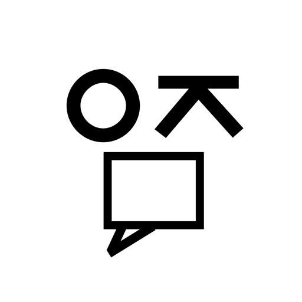
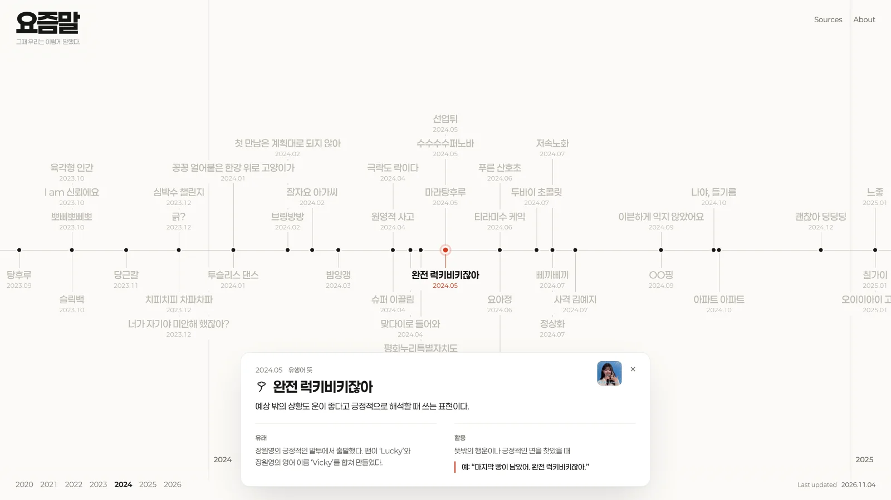

<div align="center">



# 요즘말

**그때 우리는 이렇게 말했다.**

A timeline of Korean slang, from 2020 to now.


<br>
<br>



<sub>[Live site](https://jamieryu.com/yojeumal/) &nbsp;·&nbsp; [The timeline](#the-timeline) &nbsp;·&nbsp; [How a word gets on the line](#how-a-word-gets-on-the-line) &nbsp;·&nbsp; [Add a word](#add-a-word)</sub>

</div>

<br>

Some phrases move fast. Everyone says them for a few months, then nobody remembers where they came from or why they were funny. 요즘말 keeps them on one line, each with a short note on what it means, where it started, and when to use it.

> [!NOTE]
> The site is written in Korean. Every term, definition, and example on it is in Korean, with no translated version.

## The timeline

| Feature | What it does |
|---|---|
| **One line** | Every term sits at its date on a single horizontal timeline. |
| **Move around** | Drag, swipe, scroll, or use the year rail to jump straight to a year. |
| **Open a card** | Click a term to read its meaning, origin, usage, and an example. |
| **Archive frames** | 13 terms also have a photo from the moment they came from. |
| **Share a term** | The URL follows the open card, so any term can be linked directly. |
| **Works on phones** | Cards, spacing, and the year rail all adjust to small screens. |

> [!TIP]
> Add a term to the address to open it right away, like [`jamieryu.com/yojeumal/#무야호`](https://jamieryu.com/yojeumal/#무야호).

## How a word gets on the line

New doesn't mean popular, so not every abbreviation makes it. Three things decide what stays:

1. **People really said it.** It was repeated in conversations, comments, and edits, not just once in a piece of content.
2. **It has a traceable origin.** The video, song, broadcast, or interview it came from is noted on the card.
3. **Its date holds up.** The date is checked against press coverage, year-end recaps, or monthly meme records.

The checked references are listed on the [Sources](https://jamieryu.com/yojeumal/sources/) page.

> [!NOTE]
> A term shows its exact date when the original release is known. Otherwise it uses the month the phrase spread, placed at mid-month on the line. Neither one claims to be the first time anyone said it.

## Why I made this

> 유행은 빠르고, 뜻은 자주 놓치니까.
>
> Trends move fast, and the meaning often gets missed. This is for the words you've seen everywhere but feel too late to ask about.

## Get started

There's nothing to install. Serve the folder and open [localhost:8000](http://localhost:8000).

```sh
python3 -m http.server 8000
```

## Add a word

All of the data lives in `script.js`. Each term is one row in `trends`, plus one entry per object under the same Korean key.

| Object | Holds | Required |
|---|---|---|
| `trends` | The date (`YYYY-MM-DD` or `YYYY-MM`) and the term | Yes |
| `definitions` | What it means | Yes |
| `origins` | Where it came from | Yes |
| `usageDetails` | When to use it, and an example | Yes |
| `iconPaths` | An icon for the card | No |
| `mediaDetails` | An archive frame from `assets/` | No |

```js
const trends = [
  ["2021-01", "무야호"],
];

const definitions = {
  "무야호": "아주 신나거나 만족스러운 순간에 외치는 감탄사로 쓰여요.",
};

const usageDetails = {
  "무야호": ["신나거나 일이 잘 풀렸을 때", "“내일 휴강이다. 무야호!”"],
};
```

> [!WARNING]
> A missing or misspelled key won't cause an error. The card quietly falls back to generic placeholder text, so open the new term and read it before shipping.

> [!IMPORTANT]
> After changing the data, update the `end` date in `script.js` and the **Last updated** date in `index.html`, then bump the `?v=` on any changed `script.js` or `styles.css` link so browsers don't serve the old file.

<details>
<summary><b>Project layout</b></summary>
<br>

| Path | Contents |
|---|---|
| `index.html` | The timeline page |
| `script.js` | All slang data, plus layout, dragging, cards, and links |
| `styles.css` | Styles for every page |
| `about/` | The About page |
| `sources/` | The Sources page |
| `assets/` | Archive frames |
| `docs/readme/` | Images for this README |

</details>

<details>
<summary><b>How a date becomes a position</b></summary>
<br>

Each date turns into a pixel offset from January 1, 2020, at 3.15 pixels per day. Month-only dates land on the 15th.

```js
function xFor(date) {
  const positionDate = date.length === 7 ? `${date}-15` : date;
  return ((new Date(`${positionDate}T00:00:00`) - start) / day) * pixelsPerDay;
}
```

Labels are then packed into lanes above and below the line, so busy months stay readable.

</details>

## Credits

- **Sources:** the 50 articles and records behind the dates are on the [Sources](https://jamieryu.com/yojeumal/sources/) page.
- **Type:** [Paperlogy](https://github.com/fonts-archive/Paperlogy), loaded from jsDelivr. Without that connection, the site falls back to the device's Korean font.

> [!IMPORTANT]
> Quoted phrases and archive frames belong to their respective rights holders. They appear here to document how each phrase was used.

<br>

<div align="center"><sub>YOJEUMAL · © 2026 Jamie Ryu</sub></div>
